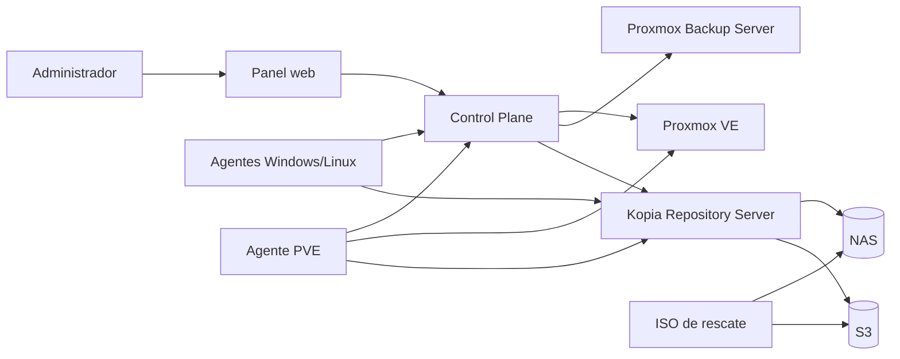
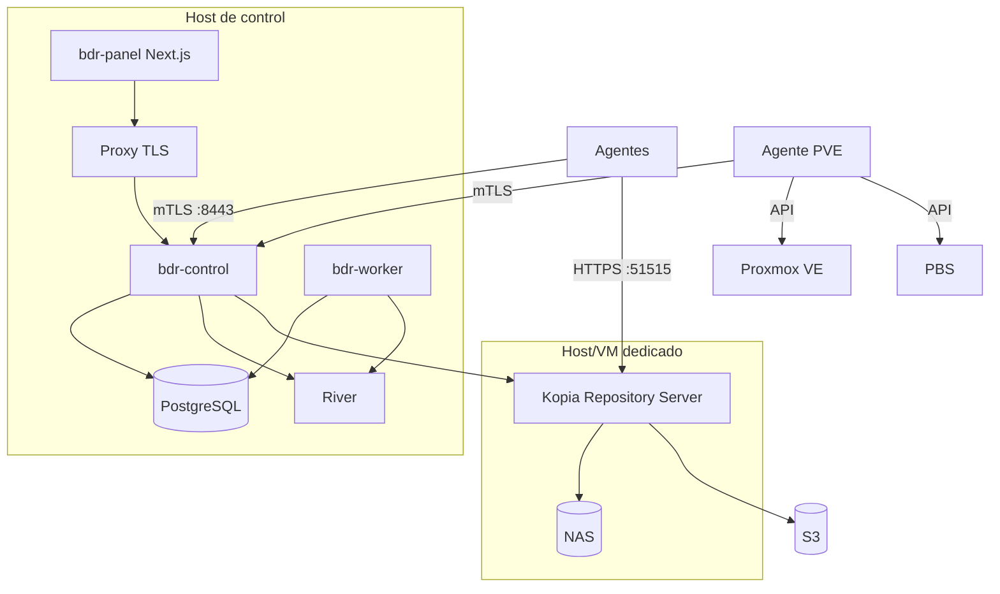
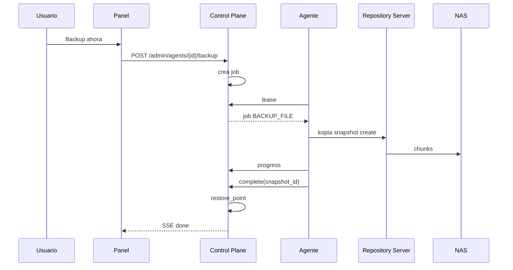
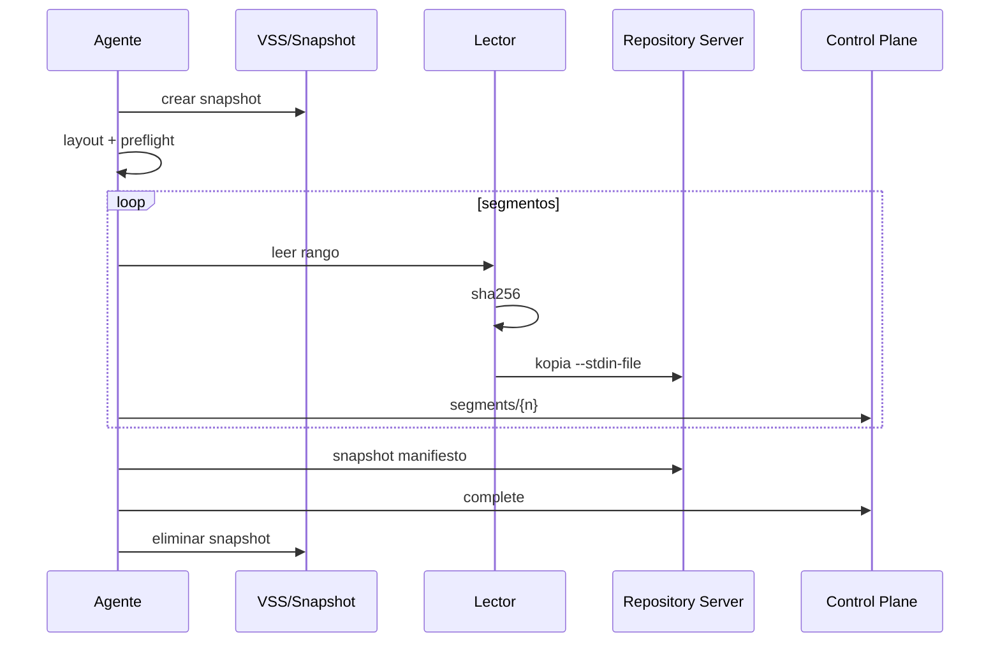
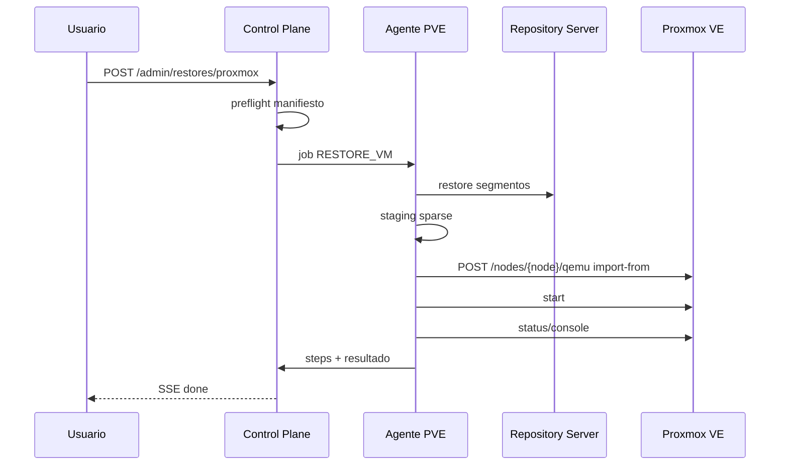
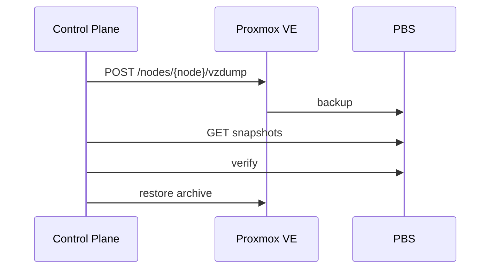
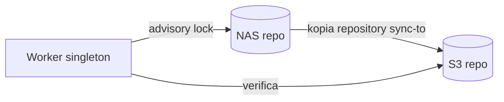
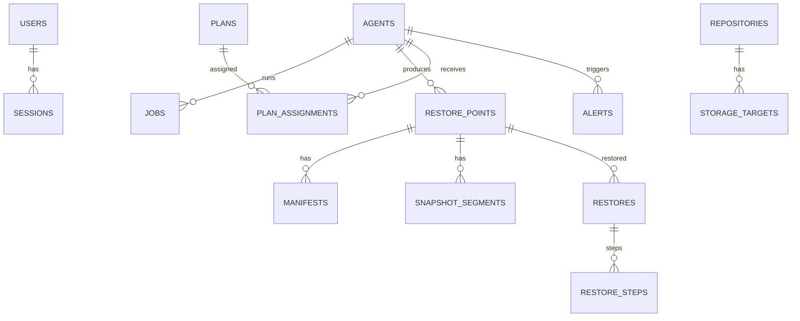
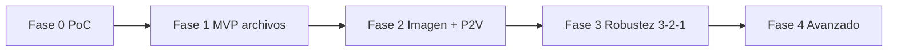
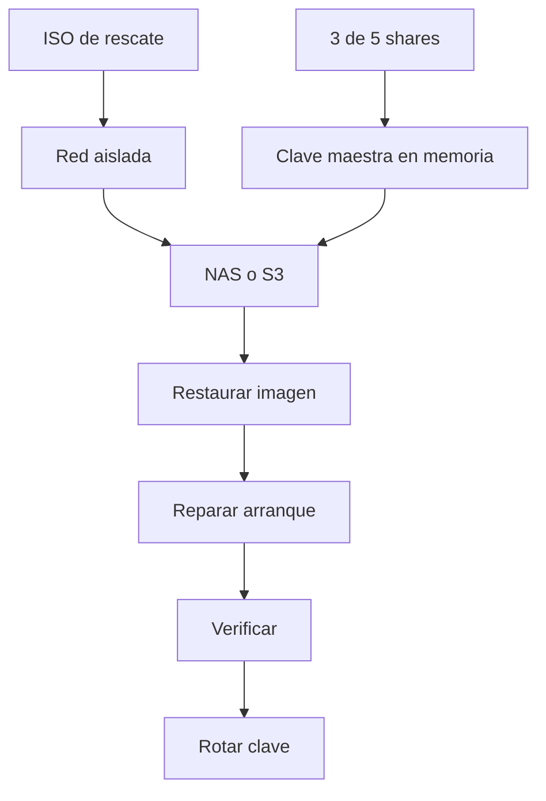

# Anexo F — Diagramas

**Documento:** anexos/f-diagramas  
**Versión:** 1.0  
**Formato:** Mermaid; se puede renderizar en GitHub o en la documentación.

---

## 1. Contexto

---

## 2. Contenedores

---

## 3. Backup de archivos

---

## 4. Backup de imagen

---

## 5. Restauración P2V

---

## 6. PBS

---

## 7. Réplica

---

## 8. Modelo de datos (resumen)

---

## 9. Fases

---

## 10. Break-glass

